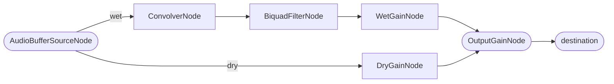

# Reverb.js

A reverb effect class built on the **Web Audio API**.
It synthesizes an impulse response (IR) using colored noise and applies reverb via `ConvolverNode`.

## Installation

```bash
pnpm add @logue/reverb
# or
npm install @logue/reverb
```

## Basic Usage

```typescript
import Reverb from "@logue/reverb";

// Create AudioContext (must be called after a user interaction)
const ctx = new AudioContext();

// Create a Reverb instance
const reverb = new Reverb(ctx, {
  time: 2,   // IR length (seconds)
  decay: 2,  // decay rate
  mix: 0.5,  // Dry/Wet ratio (0–1)
});

// Create a source node and connect it through the reverb
const source = ctx.createBufferSource();
source.buffer = await loadAudioBuffer(ctx, "/your-audio.mp3");
source.loop = true;

// connect() returns the OutputGainNode — chain it to destination
reverb.connect(source).connect(ctx.destination);
source.start();
```

## Signal Flow



## API Reference

### Constructor

```typescript
new Reverb(ctx: AudioContext, options?: Partial<ReverbOptions>)
```

| Option       | Type               | Default     | Description                          |
| ------------ | ------------------ | ----------- | ------------------------------------ |
| `time`       | `number`           | `2`         | IR length (seconds, 1–50)            |
| `decay`      | `number`           | `2`         | Decay rate (0–100)                   |
| `delay`      | `number`           | `0`         | Pre-reverb delay (ms, 0–100)         |
| `reverse`    | `boolean`          | `false`     | Reverse the IR                       |
| `mix`        | `number`           | `0.5`       | Dry/Wet ratio (0–1)                  |
| `noise`      | `Noise`            | `'white'`   | Noise type for IR generation         |
| `peaks`      | `number`           | `2`         | Number of noise peaks                |
| `scale`      | `number`           | `1`         | Noise scale                          |
| `filterType` | `BiquadFilterType` | `'allpass'` | Filter type                          |
| `filterFreq` | `number`           | `2200`      | Filter frequency (Hz, 20–20000)      |
| `filterQ`    | `number`           | `1`         | Filter Q value (0–10)                |
| `once`       | `boolean`          | `false`     | Prevent double-connect               |

### Methods

#### `connect(sourceNode: AudioNode): AudioNode`

Connects the source node through the reverb. Chain the returned `AudioNode` to `destination`.

```typescript
reverb.connect(source).connect(ctx.destination);
```

#### `disconnect(sourceNode?: AudioNode): AudioNode | undefined`

Disconnects the reverb. Use this for real-time ON/OFF toggling.

```typescript
const dry = reverb.disconnect(source);
dry?.connect(ctx.destination);
```

#### Real-time parameter changes

All parameters can be changed while playing.

```typescript
reverb.mix(0.7);
reverb.time(5);        // regenerates IR
reverb.decay(3);       // regenerates IR
reverb.reverse(true);  // regenerates IR
reverb.filterType("lowpass");
reverb.filterFreq(4000);
reverb.setNoise("pink"); // regenerates IR
```

## Noise Types

Switching the colored noise type changes the character of the reverb.

| Type            | Character                                 |
| --------------- | ----------------------------------------- |
| `white`         | Flat spectrum. Standard reverb            |
| `pink`          | Low-frequency rich. Natural spatial feel  |
| `brown` / `red` | Even more low-frequency. Deep reverb      |
| `blue`          | High-frequency rich. Bright character     |
| `violet`        | Most high-frequency                       |
| `green`         | Mid-frequency rich                        |

## Version Info

```typescript
console.log(Reverb.version); // package version
console.log(Reverb.build);   // build timestamp
```

## License

MIT © [Logue](https://logue.dev/)
